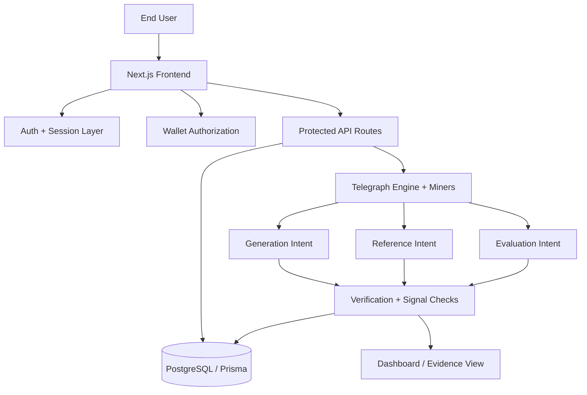
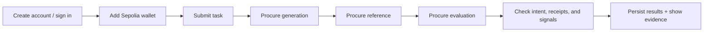
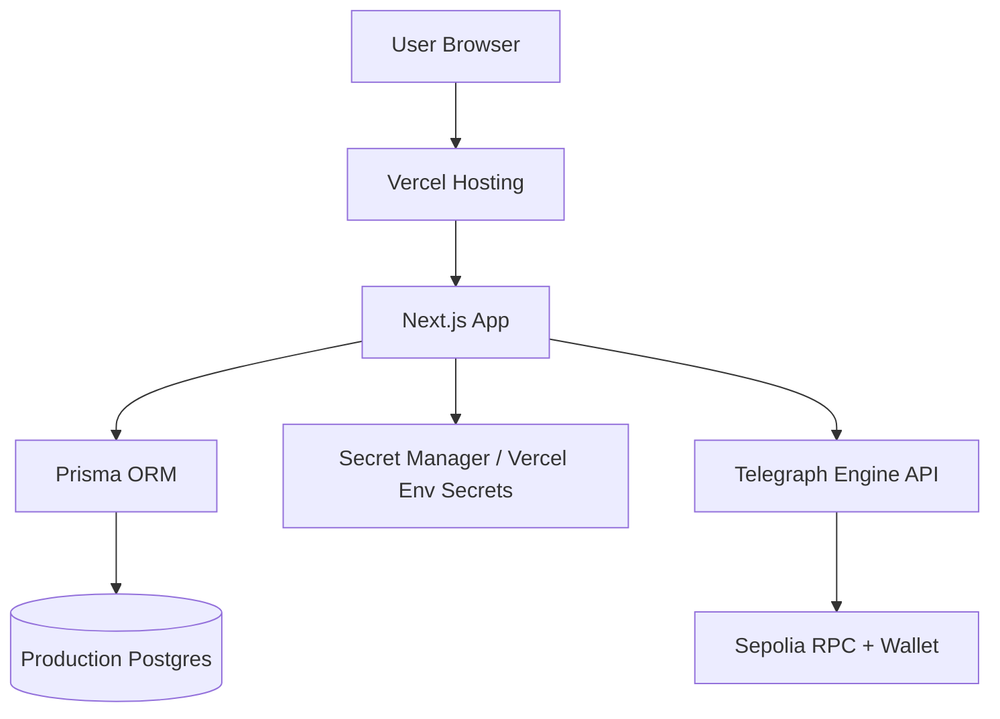

# VeriProcure AI


Live demo: https://veriprocure-ai.vercel.app

VeriProcure AI is a production-minded, user-authenticated procurement dashboard for verified AI/LLM execution on the Telegraph ecosystem. It lets a user sign up, connect a Sepolia wallet, submit a task for procurement, and review evidence of the returned intents, miners, costs, and verification outcomes.

The app follows a structured three-step flow:

1. a generated answer,
2. a reference answer, and
3. an evaluation of the generated answer.

Each step is paid through Telegraph’s x402-compatible flow, and the app records the actual intent, miner, latency, receipt metadata, cost, and verification outcome for later review.

This project is built for a hackathon and for real-world public deployment readiness. It combines a Next.js frontend, Prisma/PostgreSQL persistence, a secure auth session layer, wallet authorization, a public evidence dashboard, and a transparent verification pipeline designed for procurement-grade AI workflows.

## Project vision

The core idea is simple:

- Make AI procurement auditable instead of opaque.
- Ensure buyers know which Intent was actually returned by the engine.
- Give each user their own wallet authorization model instead of a single global wallet.
- Record what was paid, what was returned, and whether the response actually matched the expected workflow.
- Keep the public-facing app clean and non-sensitive while storing private keys and credentials in a secure host-managed environment.

## Live site overview

The current live deployment is available at:

- https://veriprocure-ai.vercel.app

End users can:

- create an account or sign in,
- add a Sepolia wallet address and configure wallet authorization,
- submit a task for procurement,
- watch the app run the three-step procurement flow,
- review evidence: costs, miner names, intents, signal hashes, and verification results.

## What the app does

The app acts like a verified procurement agent for AI tasks.

It performs a structured workflow for each task:

- Step 1: generation request
- Step 2: independent reference generation
- Step 3: evaluation of the result

At each stage it checks:

- which Intent actually returned,
- which Miner served the request,
- whether the price challenge was valid,
- whether the returned signal and receipt are available,
- whether the full transaction chain is consistent enough to mark it as verified.

The app stores the provenance of every run, which is useful for demoing, auditing, and future benchmarking.

## Architecture overview

### High-level architecture



### End-user workflow



### Production architecture



## How the procurement flow works

The app’s core flow is a three-part verification loop.

### 1. Generation

The system asks for a generated answer for a task and records:

- returned intent,
- returned miner,
- cost,
- latency,
- receipt information,
- signal hash,
- status of verification.

### 2. Reference procurement

The app independently procures a reference answer for the same task so the generated result can be judged against a second source of truth.

### 3. Evaluation

The app asks the engine to evaluate the generated answer against the task and reference result.

This makes the run more transparent and gives a user a traceable evidence trail instead of a black-box output.

## User experience on the deployed site

On the live app, the user goes through this flow:

1. Sign up or log in.
2. Add their Sepolia wallet to the wallet panel.
3. Submit a task in the main procurement panel.
4. Watch the app progress through generation, reference, and evaluation phases.
5. Review evidence such as:
   - response summaries,
   - total spend,
   - time taken,
   - returned intents,
   - miner names,
   - signal data,
   - verification status.

The public UI is intentionally designed to avoid exposing private keys, raw internal config, or sensitive host metadata.

## Tech stack

- Next.js 15
- React 19
- TypeScript
- Prisma ORM
- PostgreSQL
- Vercel hosting
- Telegraph Engine + x402-style payment flow
- Sepolia testnet wallet integration
- Protected server-side API routing
- Session-based auth with Prisma-backed user records

## Core project structure

```text
.
├── prisma/
│   └── schema.prisma
├── public/
├── scripts/
│   ├── create-test-wallet.mjs
│   ├── mint-test-usdc.mjs
│   └── ...
├── src/
│   ├── app/
│   │   ├── api/
│   │   ├── globals.css
│   │   ├── layout.tsx
│   │   └── page.tsx
│   ├── lib/
│   │   ├── auth.ts
│   │   ├── config.ts
│   │   ├── logger.ts
│   │   ├── rate-limit.ts
│   │   ├── secrets.ts
│   │   ├── telegraph.ts
│   │   └── wallet-config.ts
├── .env.example
├── .env.production.example
├── .env.vercel.example
├── .gitignore
├── Dockerfile
├── azure.yaml
├── docker-compose.yml
├── docker-compose.prod.yml
├── LICENSE
├── next.config.ts
├── package.json
├── package-lock.json
├── README.md
├── vercel.json
└── ...
```

## Local setup

### Prerequisites

- Node.js 20+
- npm
- PostgreSQL database (local or hosted)
- Sepolia test ETH for gas
- Telegraph test USDC for payment verification

### Install

```bash
npm install
```

### Environment setup

Create the required environment file from the template:

```bash
cp .env.example .env.local
```

Then fill in the required values for:

- `DATABASE_URL`
- `AUTH_SECRET`
- `EVM_PRIVATE_KEY` or secret-file pattern
- payment and rate limiting settings
- RPC URL / Telegraph endpoints if required by your environment

Important:

- Never commit real env values.
- Use local development values only in `.env.local`.
- Use Vercel or another secure secret manager in production.

### Database setup

```bash
npx prisma db push
```

Or for migration-driven setup:

```bash
npm run db:migrate
```

### Run locally

```bash
npm run dev
```

Open:

- http://localhost:3000
- or the configured port in your environment

### Production build

```bash
npm run build
npm run start
```

## Security and privacy model

The application is designed to avoid exposing sensitive internals to public users.

Key protections include:

- authenticated access for wallet actions,
- user-scoped wallet authorization,
- environment separation between local and production config,
- secret-file support for deployment environments,
- rate limiting and throttling,
- redacted logging,
- public-safe health endpoints,
- no private key exposure in the frontend.

The project intentionally avoids leaking sensitive wallet metadata and private internal configuration into the browser.

## Production deployment notes

This project is configured for deployment on Vercel and is live at:

- https://veriprocure-ai.vercel.app

For a production public deployment, use:

- Vercel secret environment variables,
- a production PostgreSQL instance,
- a dedicated Sepolia wallet with limited funds,
- separate env files for dev and prod,
- a proper production secret manager if the app scales.

## Public repo readiness checklist

Before pushing the project to a public GitHub repo, make sure:

- no real `.env` files are committed,
- no wallet private keys are stored in the repo,
- no internal testing credentials or host config remain,
- the README is clean and public-safe,
- the production URL is a deployment artifact, not a dev or local link,
- the app is deployed with the correct live environment variables set by the platform.

## Limitations and honest status

This project is production-minded and publication-ready in structure, but it still has some real-world limitations depending on deployment scale:

- the in-memory rate limiter is appropriate for early-stage deployment but should be replaced with a distributed strategy if the app grows,
- live Telegraph and wallet interactions depend on testnet connectivity and valid wallet funding,
- benchmark and deterministic evaluation are still best treated as an evolving capability rather than a guarantee of perfect correctness.

The app is designed as a transparent procurement and evidence layer rather than as a black-box AI executor.

## Official references

- Telegraph Hackathon: https://hackathon.telegraphprotocol.com/
- Telegraph docs: https://docs.telegraphprotocol.com/
- x402 documentation: https://docs.telegraphprotocol.com/docs/using/x402-inference
- Engine usage docs: https://docs.telegraphprotocol.com/docs/using/engine-ask

## License

This project is licensed under the MIT License. See [LICENSE](./LICENSE) for details.
